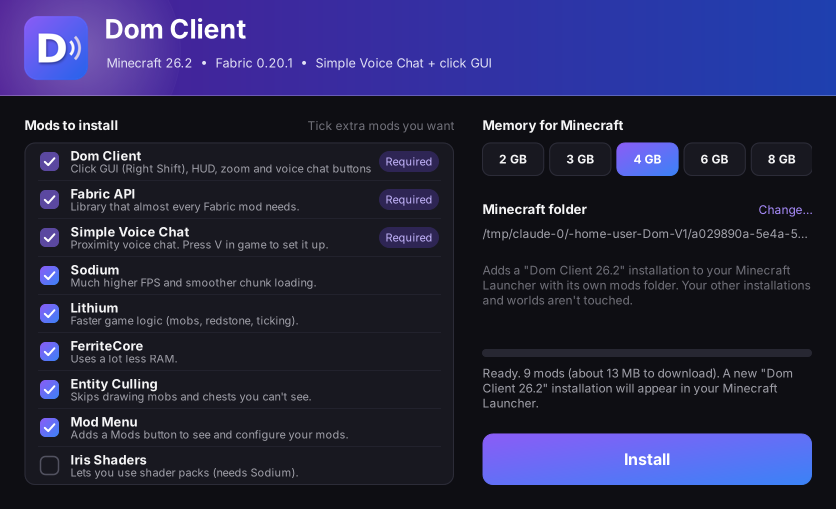
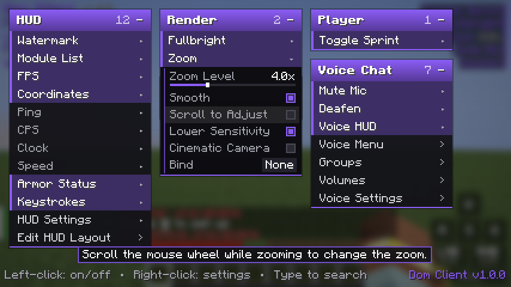
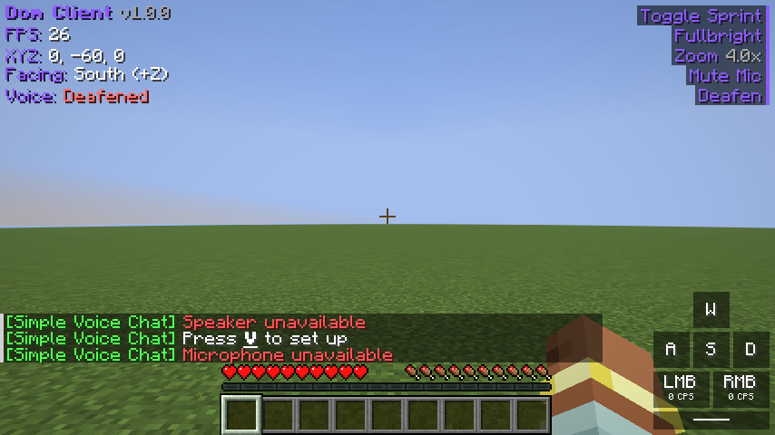

# Dom Client (Dom-V1)

A one-click installer for **Minecraft Java 26.2** that sets you up with:

- **Simple Voice Chat**: proximity voice chat with your friends
- **Dom Client**: a click GUI with dropdown menus (press **Right Shift** in game) with HUD, zoom, fullbright, toggle sprint and quick voice chat buttons
- **Fabric** (the mod loader) plus optional performance mods: Sodium, Lithium, FerriteCore, Entity Culling, Mod Menu and Iris Shaders

The installer adds a **"Dom Client 26.2"** installation to the normal Minecraft Launcher. Pick it next to the Play button and play.

| Installer | Click GUI (Right Shift) | HUD |
| --- | --- | --- |
|  |  |  |

## Install (Windows 10 / 11)

1. Download **[Dom-V1-Installer.exe](https://github.com/adenthegoat565/Dom-V1/releases/latest/download/Dom-V1-Installer.exe)** from the [Releases page](https://github.com/adenthegoat565/Dom-V1/releases).
2. Open it. If Windows says *"Windows protected your PC"*, click **More info → Run anyway**. (The installer isn't code-signed, which costs money. That's why Windows warns.)
3. Tick any extra mods you want, pick how much RAM Minecraft gets, and click **Install**.
4. Click **Open Launcher** (or open the Minecraft Launcher yourself), choose **Dom Client 26.2** next to the green Play button, and press **Play**.

You need the official Minecraft Launcher, from minecraft.net or the Xbox app / Microsoft Store (both work), and you should have opened it at least once. You don't need to install Java or Fabric yourself.

Close the Minecraft Launcher before installing. If it was open, restart it so the new installation shows up.

## In game

| Key | What it does |
| --- | --- |
| **Right Shift** | Open / close the click GUI |
| **C** (hold) | Zoom. Scroll while zooming to zoom further |
| **V** | Simple Voice Chat menu. The first time, it walks you through mic setup |
| **M** | Mute your microphone (Simple Voice Chat) |
| **N** | Turn voice chat off/on (Simple Voice Chat) |

You can change the Right Shift and zoom keys in *Options → Controls → Key Binds → Dom Client*.

### Using the click GUI

- Each category (HUD, Render, Player, Voice Chat, Client) is a panel. **Click a panel's header** to drop it down or fold it up, and **drag the header** to move it.
- **Left-click** a module to turn it on or off.
- **Right-click** a module to open its settings dropdown: sliders, on/off boxes, modes and a key bind (click *Bind*, then press a key; Esc clears it). Middle-click a module to bind it straight away.
- **Start typing** to search modules. Esc clears the search, and Esc again closes the GUI.
- Everything is saved automatically to `config/domclient.json`.

### Modules

| Panel | Modules |
| --- | --- |
| **HUD** | Watermark, Module List, FPS, Coordinates (facing, biome, Nether coords), Ping, CPS, Clock, Speed, Armor Status, Keystrokes, HUD Settings, **Edit HUD Layout** (drag HUD elements anywhere) |
| **Render** | Fullbright, Zoom (zoom level, smooth zoom, scroll to adjust, lower sensitivity) |
| **Player** | Toggle Sprint |
| **Voice Chat** | Mute Mic, Deafen, Voice HUD (shows connected / muted / talking and your group), buttons that open Simple Voice Chat's **Voice Menu**, **Groups**, **Volumes** and **Voice Settings** |
| **Client** | Click GUI: accent colour (or rainbow), background blur, darkness, descriptions, click sounds, pause singleplayer, reset panels |

All modules are client-side quality-of-life features like the ones in Lunar or Badlion. There are no cheats, so they're fine on normal servers.

## Voice chat with friends

- **Singleplayer / Open to LAN:** works straight away, because Simple Voice Chat runs inside your world.
- **On a server:** the server also needs Simple Voice Chat (the Fabric mod, or the Bukkit/Paper plugin) with UDP port **24454** open. Everyone joining needs Simple Voice Chat too, so send your friends this installer.
- The first time you press **V**, Simple Voice Chat asks you to pick push-to-talk or voice activation and test your mic.

## Adding more mods

After installing, click **Open mods folder** (or go to `%APPDATA%\.minecraft\DomClient-26.2\mods`) and drop in any **Fabric mods made for Minecraft 26.2**. Mods for other versions or for Forge/NeoForge will crash the game.

This installation has its own folder, so your normal Minecraft worlds, settings and other installations aren't touched. Your keybinds/options and server list are copied over the first time you install.

Running the installer again updates everything. It skips mods that are already up to date, removes the old versions it installed before, and keeps mods you added yourself.

## Uninstall

In the Minecraft Launcher, open **Installations**, find **Dom Client 26.2**, then click **…** and **Delete**. Then delete the folder `%APPDATA%\.minecraft\DomClient-26.2` (this also deletes worlds you made in this installation, so back them up first).

## For developers

```
mod/        Dom Client Fabric mod (Java 25, Fabric Loom, Minecraft 26.2 with official Mojang names)
installer/  Windows installer (.NET Framework 4.8 WinForms, a single .exe)
scripts/    update_modpack.py (picks mod versions from Modrinth), download_mods.py, make_icons.py
.github/    CI: builds the mod and the .exe, tests the .exe on Windows, launches Minecraft
            under Xvfb to click through the GUI, and publishes the installer to Releases
```

**Build the mod** (needs JDK 25):

```bash
cd mod && ./gradlew build
```

**Build the installer** (needs the .NET 8 SDK; works on Windows, macOS or Linux):

```bash
cp mod/build/libs/dom-client-*.jar installer/payload/
cd installer && dotnet build -c Release
```

The `.exe` lands in `installer/bin/Release/net48/`. It also has a silent mode for scripts:
`Dom-V1-Installer.exe --silent [--minecraft-dir DIR] [--ram 4] [--mods sodium,iris] [--log install.log]`.

**Update mod versions:** `python3 scripts/update_modpack.py` rewrites `installer/payload/modpack.json` (URLs + SHA-512 hashes from Modrinth) and the Fabric Loader profile.

**In-game test:** `xvfb-run ./gradlew runClientGameTest -PextraModsDir=/path/to/mods` (run from `mod/`) starts Minecraft, opens the click GUI with Right Shift, clicks modules, searches, zooms, presses the voice chat buttons and saves screenshots to `mod/build/run/clientGameTest/screenshots/`.

Third-party mods are never bundled in this repository or the `.exe`. The installer downloads them from Modrinth at install time and checks each SHA-512 hash, the same way Modrinth modpacks do.
